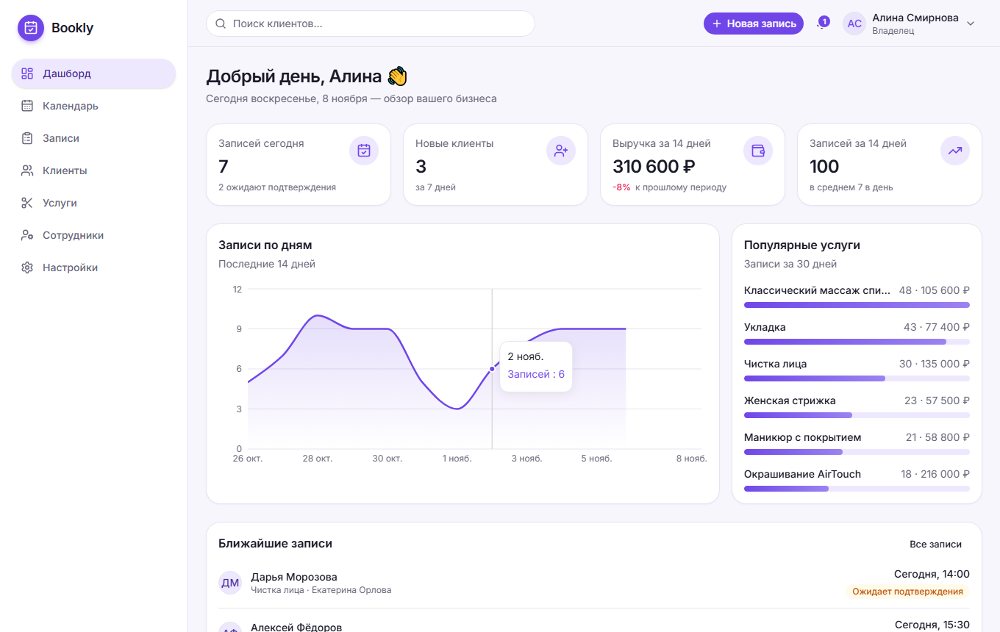
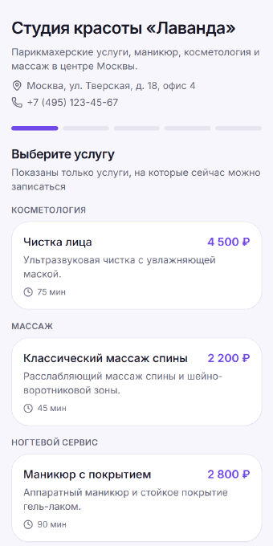
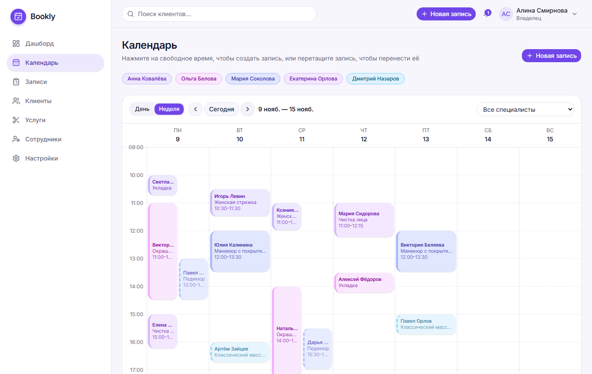
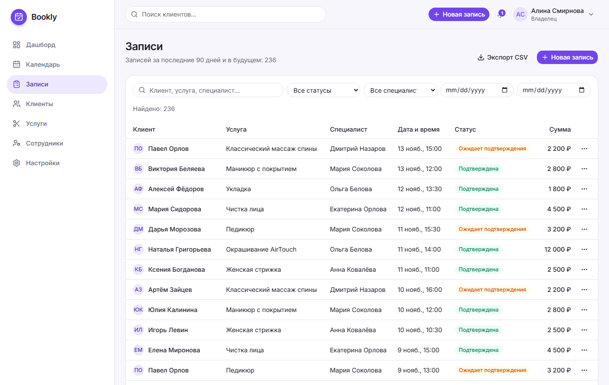
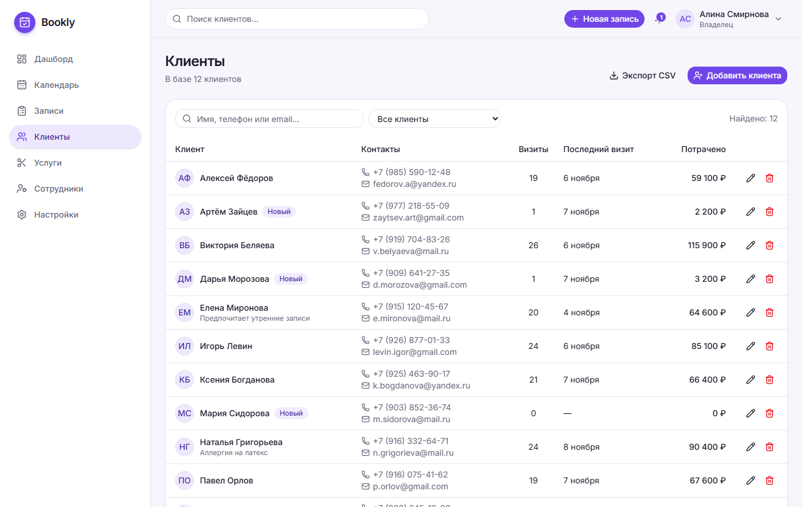
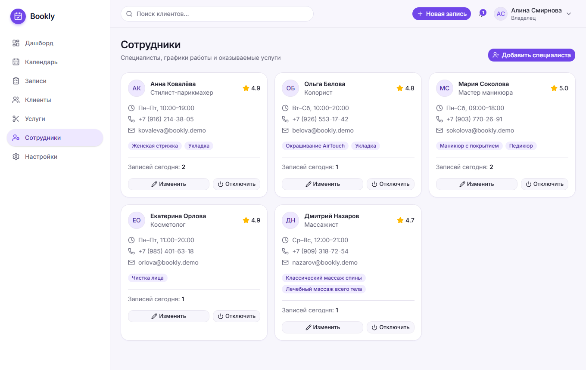
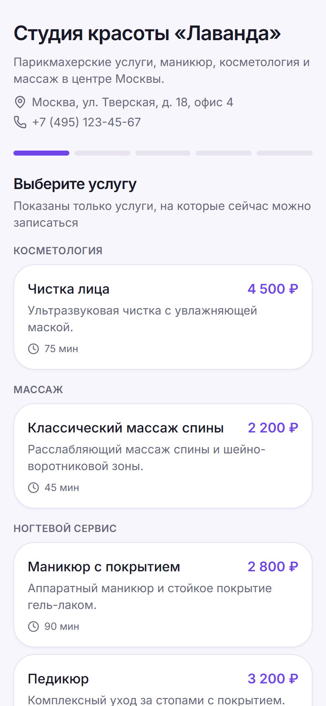
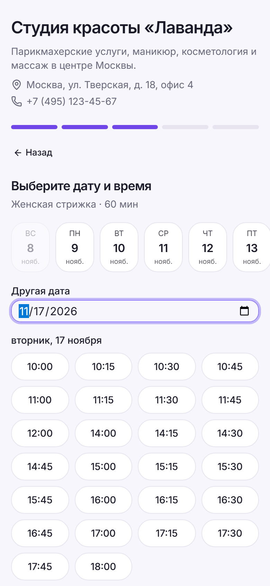
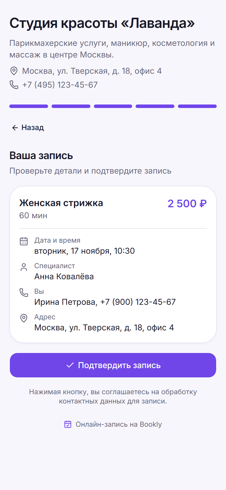
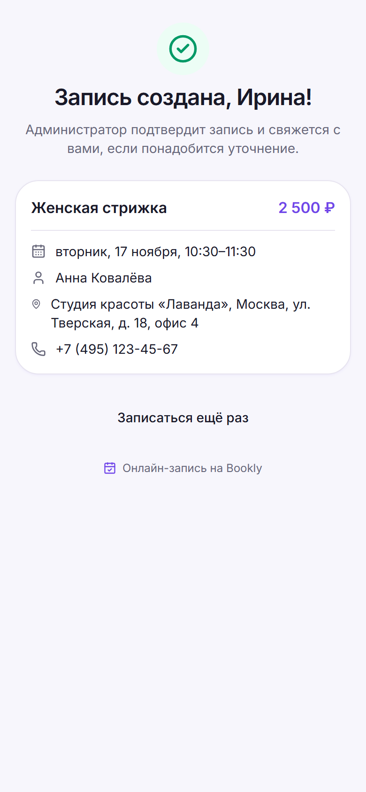

# Bookly

Веб-приложение для онлайн-записи клиентов и управления расписанием салона красоты или студии: админ-панель для команды и публичная страница записи для клиентов (без регистрации).

> Учебный/портфолио-проект. Демо-данные (салон «Лаванда», клиенты, телефоны, email) полностью вымышлены.



## Живое демо

**https://bookly-psi-rose.vercel.app**

| Что посмотреть | Адрес / вход |
|---|---|
| Главная страница | [bookly-psi-rose.vercel.app](https://bookly-psi-rose.vercel.app) |
| Админ-панель (роль «администратор») | `/login`: `pavel@bookly.test` / `Password123!` |
| Публичная онлайн-запись клиента | `/book/lavanda-demo` (вход не нужен) |

Это общий демо-стенд с вымышленными данными: пароль публичный, а данные видят и могут менять все посетители. Пожалуйста, не вводите настоящие имена, телефоны и email. Демо-данные периодически возвращаются к исходным (задача pg_cron, настройка — [docs/DEPLOY.md](docs/DEPLOY.md)).

<p align="center"><br><sub>Онлайн-запись с телефона: от выбора услуги до подтверждения</sub></p>

Пошаговый сценарий проверки для заказчика — [docs/DEMO.md](docs/DEMO.md).

## Возможности

**Админ-панель** (после входа)
- **Дашборд:** записи сегодня, новые клиенты, выручка и записи за 14 дней, график записей, популярные услуги, ближайшие записи. Все цифры считаются из базы.
- **Календарь:** вид «День» и «Неделя», фильтр по специалисту, создание записи кликом по свободному времени, перенос перетаскиванием, проверка пересечений.
- **Записи:** создание, редактирование, отмена, пять статусов (ожидает, подтверждена, завершена, отменена, клиент не пришёл), поиск и фильтры.
- **Клиенты:** добавление, правка, удаление, поиск и фильтры, страница клиента с историей визитов.
- **Услуги:** создание, правка, включение и отключение.
- **Сотрудники:** специалисты, назначенные услуги, недельное расписание с перерывом, временное отключение.
- **Настройки:** данные компании, часы работы, ссылка на публичную страницу записи.
- **CSV-экспорт** клиентов и записей (владелец и администратор).
- **Уведомления** о новых записях, в том числе онлайн.

**Публичная онлайн-запись** `/book/<slug>`
- услуга → специалист или «любой» → дата → свободное время → контакты → проверка → подтверждение → страница успеха;
- свободное время считается в базе с учётом рабочего расписания, перерывов, длительности услуги и уже созданных записей; перед сохранением доступность проверяется повторно;
- не раньше чем через час от текущего момента, не дальше 60 дней вперёд;
- защита от спама: поле-ловушка, минимальное время заполнения, лимиты по IP, телефону и организации;
- адаптирована под телефон.

**Безопасность и роли**
- Supabase Auth (email + пароль), защищённые маршруты;
- роли **owner / admin / staff**, доступ к данным ограничен Row Level Security (политики в миграциях) — каждый видит только данные своей организации;
- ключ `service_role` приложению не нужен и нигде не используется, браузер получает только публичный anon-ключ.

## Технологии

Next.js 16 (App Router, Server Components и Server Actions) · React 19 · TypeScript · Tailwind CSS 4 · shadcn/ui (на Base UI) · Lucide · Recharts · Zod · Supabase (PostgreSQL, Auth, RLS) · Playwright · PGlite (тесты БД без Docker).

## Скриншоты

| Календарь | Записи |
|---|---|
|  |  |
| **Клиенты** | **Сотрудники** |
|  |  |

Публичная запись на телефоне:

| Услуга | Время | Проверка | Готово |
|---|---|---|---|
|  |  |  |  |

Остальные страницы: [вход](docs/screenshots/login.png), [услуги](docs/screenshots/services.png), [настройки](docs/screenshots/settings.png), [дашборд на телефоне](docs/screenshots/mobile-dashboard.png). Скриншоты получены из реального приложения командой `npm run screenshots`, GIF — командой `npm run demo:gif`.

## Быстрый старт

Нужны Node.js **22.18+** и проект Supabase (облачный или локальный).

```bash
git clone <repo-url> bookly && cd bookly
npm install
cp .env.example .env.local        # заполните две переменные Supabase (см. ниже)
npm run dev                       # http://localhost:3000
```

### Без Supabase (локальный стенд)

Чтобы посмотреть приложение без аккаунта Supabase и без Docker, есть эмулятор (миграции и seed настоящие, Auth и REST-слой упрощены):

```bash
npm run emulator                  # терминал 1: http://127.0.0.1:54321
# терминал 2, .env.local:
#   NEXT_PUBLIC_SUPABASE_URL=http://127.0.0.1:54321
#   NEXT_PUBLIC_SUPABASE_ANON_KEY=any-value
npm run dev
```
Вход: `pavel@bookly.test` (администратор) или `alina@bookly.test` (владелец), пароль `Password123!` (демо-пароль из seed, см. [docs/DEMO.md](docs/DEMO.md)). Данные живут в памяти до перезапуска эмулятора.

## Настройка Supabase

1. Создайте проект на [supabase.com](https://supabase.com).
2. **SQL Editor:** выполните по порядку файлы из [`supabase/migrations/`](supabase/migrations) (`20261106000001_schema.sql` … `20261109000001_protect_org_slug.sql`, шесть файлов).
3. Демо-данные (необязательно, только для демо-проекта): выполните [`supabase/seed.sql`](supabase/seed.sql). Он создаёт двух вымышленных организаций, пользователей и записи; даты считаются от сегодняшнего дня. **Не запускайте seed на проекте с реальными пользователями:** он пересоздаёт демо-аккаунты.
4. **Authentication → Providers → Email:** для демо можно отключить «Confirm email» (иначе регистрация потребует настроенную почту).
5. **Authentication → URL Configuration:** Site URL — адрес сайта, Redirect URLs — `https://<домен>/auth/callback` (и `http://localhost:3000/auth/callback` для разработки).
6. **Project Settings → API:** скопируйте Project URL и `anon` (publishable) key в переменные окружения. `service_role` **не копируйте** никуда.

Через Supabase CLI (локально, нужен Docker): `npx supabase start`, затем `npx supabase db reset` (применит миграции и seed). Этот путь в проекте не проверялся: Docker в среде разработки не использовался.

Подробности о таблицах, ролях и правах — в [supabase/README.md](supabase/README.md).

## Переменные окружения

| Переменная | Обязательна | Описание |
|---|---|---|
| `NEXT_PUBLIC_SUPABASE_URL` | да | URL проекта Supabase |
| `NEXT_PUBLIC_SUPABASE_ANON_KEY` | да | публичный (anon / publishable) ключ; безопасен для браузера, данные защищает RLS |
| `NEXT_PUBLIC_SITE_URL` | нет | адрес сайта для ссылки подтверждения email |
| `BOOKING_RATE_SALT` | нет | случайная строка-соль для хэша IP в лимитах публичной записи |
| `NEXT_PUBLIC_TURNSTILE_SITE_KEY` | нет | публичный ключ Cloudflare Turnstile: CAPTCHA на входе и регистрации (см. [docs/DEPLOY.md](docs/DEPLOY.md)) |

Шаблон — [`.env.example`](.env.example). Файлы `.env*` (кроме `.env.example`) исключены из Git.

## Тесты

```bash
npm run test:db       # БД без браузера: RLS, роли, правила записи, публичная запись, логика (PGlite, 200+ проверок)
npm run e2e           # Playwright: собирает приложение, поднимает эмулятор и проходит сценарии в браузере (67 тестов)
npm run e2e:report    # HTML-отчёт Playwright
npm run lint && npm run typecheck
```
Браузерные тесты работают на production-сборке и локальном эмуляторе Supabase; первый запуск скачивает Chromium (`npx playwright install chromium`). Подробности — [TEST_REPORT.md](TEST_REPORT.md).

## Развёртывание

Пошаговая инструкция для Vercel + Supabase: [docs/DEPLOY.md](docs/DEPLOY.md). Сценарий демонстрации для заказчика: [docs/DEMO.md](docs/DEMO.md).

## Структура проекта

```
src/
  app/
    (auth)/          вход и регистрация (server actions)
    (app)/           админ-панель: dashboard, calendar, appointments, clients, services, staff, settings
    page.tsx         главная (лендинг) со ссылками на демо
    book/[slug]/     публичная запись и страница успеха
    api/export/      CSV-экспорт
    auth/callback/   подтверждение email
  components/
    ui/              базовые компоненты shadcn/ui
    layout/ shared/  оболочка, меню, формы-диалоги, общие блоки
    dashboard/ calendar/ appointments/ clients/ services/ staff/ settings/ booking/ auth/
  lib/
    actions/         server actions (запись данных, валидация Zod)
    data/            загрузка данных организации, сессия, выборки для дашборда
    supabase/        клиенты Supabase (server, public) и защита маршрутов (proxy)
  types/
  proxy.ts           обновление сессии и защита маршрутов
supabase/
  migrations/        схема, RLS, правила записи, публичная запись
  seed.sql           вымышленные демо-данные
  tests/             тесты БД и локальный эмулятор Supabase
e2e/                 Playwright-тесты и сценарий скриншотов
scripts/             генерация demo-reset.sql и GIF для README
public/demo/         изображения для главной страницы
docs/                DEPLOY.md, DEMO.md, скриншоты
```

## Дальнейшие планы

Сознательно не входят в демо, но естественны для развития продукта:

- **Письма и SMS клиентам:** подтверждение записи, напоминание накануне визита (почтовый сервис вроде Resend, очередь отправки, защита от злоупотреблений).
- **Отмена и перенос записи клиентом** по ссылке из письма (одноразовый токен вместо входа).
- **Подтверждение записи в один клик** администратором из уведомления и автоподтверждение для проверенных клиентов.
- **Несколько филиалов и несколько смен в день**, разные часовые пояса.
- **Отчёты:** загрузка мастеров, выручка по услугам и специалистам, возвращаемость клиентов.
- **Онлайн-оплата или предоплата** для снижения неявок.
- **Реальная проверка на Supabase CLI в CI:** прогон миграций и тестов на настоящем Postgres в GitHub Actions.

## Что проверено, а что нет

Проверено автоматически (production-сборка, локальный эмулятор Supabase с настоящими миграциями и RLS): авторизация, клиенты, услуги, сотрудники, записи и календарь, публичная запись (включая мобильную версию), адаптивность, отсутствие ошибок в консоли и сети, TypeScript, ESLint, сборка.

**Не проверено:** работа на настоящем проекте Supabase (облачном или через CLI) и развёртывание на Vercel — инструкции составлены по документации, но реальный деплой не выполнялся. Перед публикацией выполните сценарий из [docs/DEMO.md](docs/DEMO.md) на своём окружении.

## Известные ограничения

- Нет писем и SMS клиентам (подтверждения, напоминания); онлайн-запись создаётся со статусом «Ожидает подтверждения», администратор подтверждает её вручную.
- Клиент не может сам отменить или перенести запись.
- Перенос записи перетаскиванием работает с мышью; на сенсорных экранах используйте форму «Изменить».
- Лимит по IP в публичной записи опирается на заголовок `x-forwarded-for` (на Vercel задаётся платформой); лимиты по телефону и организации от него не зависят.
- Один часовой пояс на организацию (по умолчанию `Europe/Moscow`), одна смена и один перерыв в день на специалиста.
- Списки записей показывают последние 90 дней и будущие; клиентская статистика считается в этом же окне (CSV и страница клиента читают всю историю).
- Для несуществующего `/book/<slug>` показывается «не найдено», но код ответа 200 (потоковая отрисовка Next.js).
